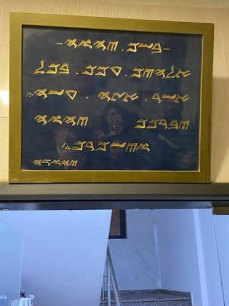
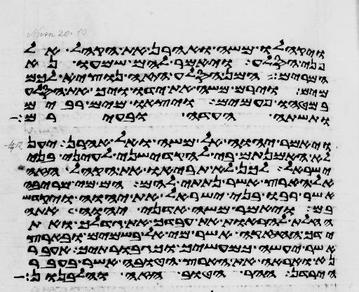
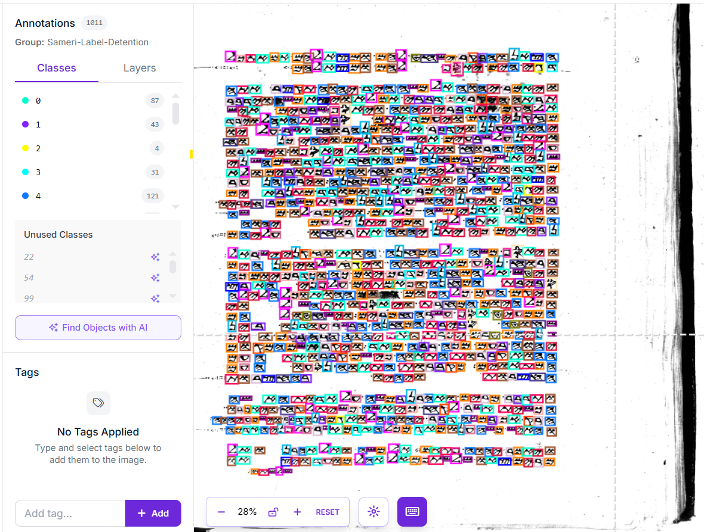
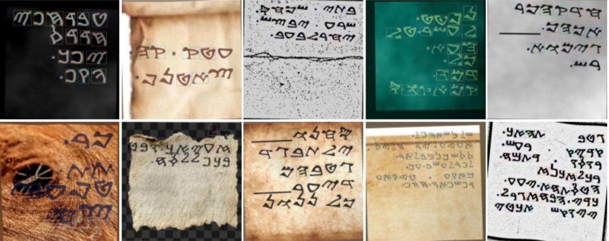
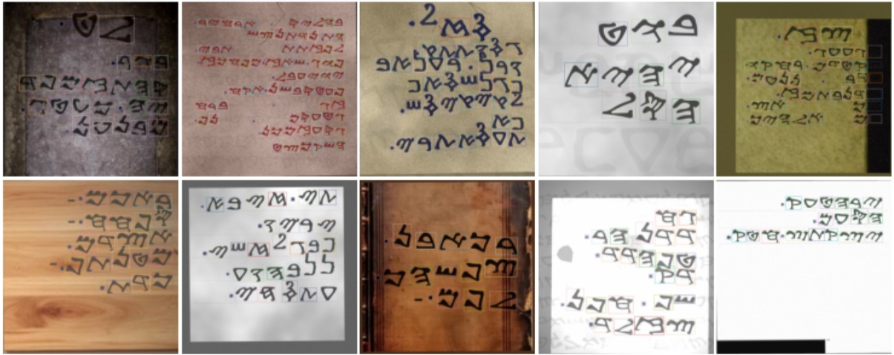
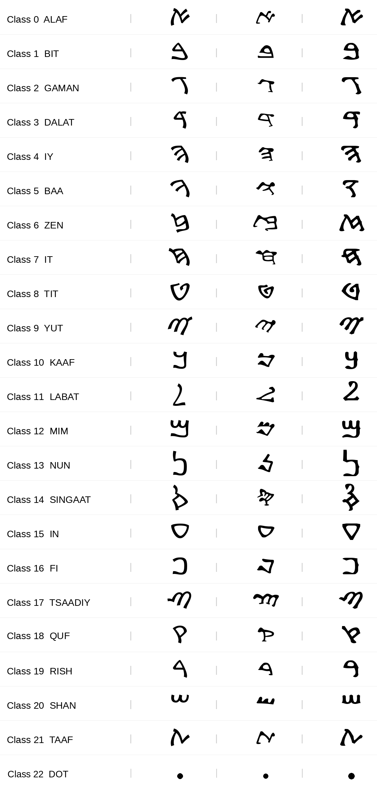

# Shamer — Samaritan Script Recognition

**شَامِر**

Shamer is a Digital Image Processing project for recognizing **Samaritan script** characters from images.
It uses a **YOLOv8n-P2** detection model to locate and classify individual characters in photos of
documents, inscriptions, and old manuscripts, and turns them into a machine-readable representation
of the text.

The model works at the **character level**: instead of classifying a whole image, it detects every
letter separately, which is what makes it possible to reconstruct words and lines from real, noisy
photographs.

---

## Demo


<!-- Add your LinkedIn post link below, then remove the comment markers:
[Watch the full demo on LinkedIn →](PUT_LINK_HERE)
-->

---

## Training Pipeline

The project follows a four-stage pipeline:

```text
Synthetic Data Generation
        ↓
Pre-training
        ↓
Fine-tuning on Real Images
        ↓
Character Detection
```

Because annotated real Samaritan data is scarce, the model is first trained on a large corpus of
synthetic images, then adapted to real photographs with a smaller, manually labeled set. Detection
happens per character, so the output is a set of bounding boxes with class names and confidence
scores, which are then grouped into lines and read from right to left.

---

## Try the Model

The trained model is included as an ONNX file (`models/samerocr_yolov8n_p2.onnx`), and a small web
interface lets you upload an image and see the result. It only needs ONNX Runtime, OpenCV and
Gradio - **PyTorch is not required**.

```bash
git clone https://github.com/Abdullah-Al-basheri/shamer-samaritan-ocr.git
cd shamer-samaritan-ocr
pip install -r requirements.txt
python app.py
```

Then open **http://127.0.0.1:7860** in your browser, upload an image, and press **Recognize**.

The interface shows:

- the image with a box around every detected character,
- the **highest confidence** found among the detections,
- the recognized text in Samaritan Unicode (right-to-left, `DOT` shown as a space),
- the character names in reading order.

---

## Real Data Samples

Examples of the real images used for fine-tuning (unlabeled samples):

| Inscription                  | Manuscript                   |
| ---------------------------- | ---------------------------- |
|  |  |

---

## Real Images Labeling

The fine-tuning stage relied on **200 real images that were annotated manually**, one box per
character. Producing these labels by hand was an essential part of preparing the real dataset,
since no ready-made annotated Samaritan dataset was available.


*Character-level manual annotation in Roboflow*

> The labeled dataset itself is not included in this repository.

---

## Data & Training

- Around **65,000 synthetic images** were generated to provide diverse training data.
- These synthetic images were used for the **Pre-training** stage.
- The pretrained model was then **fine-tuned on real images**.
- **200 real images** were prepared and annotated manually for this stage.
- Fine-tuning on real data is what lets the model cope with real-world photographs.

### Synthetic Data Samples

Samples of the synthetic images generated for pre-training, with different backgrounds, inks, and degradations:





---

## Why YOLOv8n-P2?

Samaritan characters are small and can carry fine details, especially in photographs of inscriptions
and old documents. YOLOv8n-P2 keeps an early, higher-resolution detection head (the P2 level), which
preserves the spatial detail needed to detect small objects - a good fit for characters of this size.

---

## Android App

[Download Android App (APK)](https://github.com/Abdullah-Al-basheri/shamer-samaritan-ocr/releases/latest/download/shamer.apk)

---

## Repository Contents

The training code is contained in two Jupyter notebooks under `src/`.

### `src/Generate_&_Pretraining_Alsameri.ipynb`

- Synthetic data generation (documents rendered with Samaritan fonts).
- YOLO dataset preparation (`data.yaml`, deterministic train/val split).
- Variations, noise, and degradation applied to the rendered images
  (ink, geometry, and camera/paper degradation stages).
- The **Pre-training** stage.
- Previews and quality checks (QA) on the generated data.

> **Note on `CONFIG`:** during generation, some `CONFIG` values were **manually adjusted between
> runs** to increase variety and noise in the synthetic data. The values currently present in
> `CONFIG` are not necessarily a fixed setup that was used for every generation run.

### `src/FineTune_Alsameri.ipynb`

- Preparing the real images and their labels.
- **Fine-tuning** the pretrained model.
- Data augmentation for the real images.
- Train/val/test split.
- Model evaluation on a held-out test set.
- Testing the model and extracting characters from an image.

---

## Classes

The model detects **23 classes**: **22 Samaritan characters + `DOT`**.

<p align="center">
  
</p>

The class order is fixed and must not be changed, otherwise the model weights will no longer match
the labels.

---

## Technologies

- Python
- Google Colab
- Ultralytics
- YOLOv8n-P2
- PyTorch
- ONNX / ONNX Runtime
- OpenCV
- NumPy
- Pillow
- Gradio
- Flutter (Android app)
- Roboflow (manual labeling)

---

## Project Structure

```text
shamer-samaritan-ocr/
├── assets/
│   ├── demo.gif
│   ├── Real_1.jpg
│   ├── Real_2.jpg
│   ├── Img_Label.png
│   ├── Classes.png
│   ├── Gen_01.jpg
│   └── Gen_02.jpg
├── doc/
│   └── Shamer.pptx
├── fonts/
│   └── NotoSansSamaritan-Regular.ttf
├── models/
│   └── samerocr_yolov8n_p2.onnx
├── src/
│   ├── Generate_&_Pretraining_Alsameri.ipynb
│   └── FineTune_Alsameri.ipynb
├── app.py
├── requirements.txt
└── README.md
```

---

## Important Note

The notebooks were built to run in **Google Colab**. Several data paths and training files rely on
**Google Drive** and on the specific files that were used during development, so some paths may need
to be updated to match your own environment before running them.

---

## Credits & Author

**Shamer** is my work, developed under the supervision of **Dr. Akram Al-Sabari**.

### Abdullah Al-Basheeri

<p>
  <a href="https://github.com/Abdullah-Al-basheri">
    
  </a>
    
  <a href="https://www.linkedin.com/in/abdullah-al-basheri-8a9655393">
    
  </a>
    
  <a href="https://www.facebook.com/profile.php?id=100082263520120">
    
  </a>
</p>
